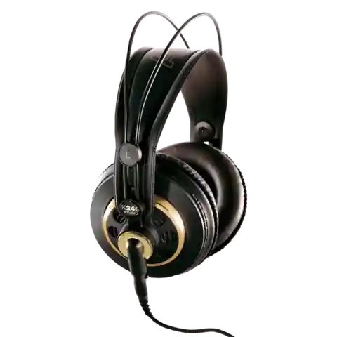
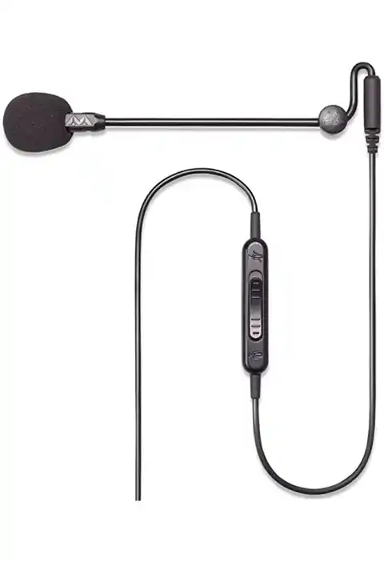
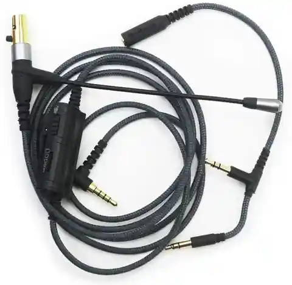
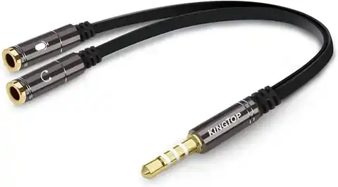
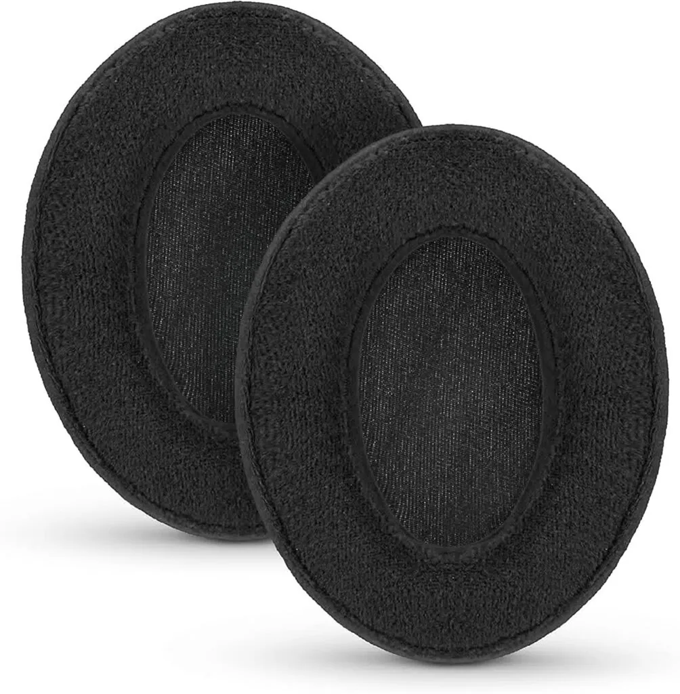

I have frequently been asked about hardware recommendations for all sorts of things including audio and I will be documenting my own audio setup I personally use completely in another article. I did recently come up with an inexpensive solution for my headphones at work so I can enjoy music as well as all of my meetings properly without spending too much money, but still allowing myself the enjoyment of quality music at work. These headphones can actually work as well for an inexpensive gaming headset that can even work with Xbox and Playstation as well.

<!--more-->

Some links in this post are Amazon affiliate links. If you buy through one, I may earn a small commission at no extra cost to you.

What we first need to understand when I was making my choices is that most gaming headsets are actually not that great quality for the price, most of the money is going into the marketing and brand, where as in the audiophile world, the best brands are known usually by word of mouth instead. Now while there are obviously much higher end and better quality setups than this, the main goal was something inexpensive, comfortable, but also more enjoyable than the stock headsets they give at work. My main goal was to try and find a headset with a microphone, that is comfortable to wear, but also not out of place in a business meeting, that can also be used for gaming for less than a total of $100 and I was able to do just that with three separate pieces of hardware.

## Headphones: AKG K240 Studio

AKG K240 Studio Headphone Image from AKG

These headphones have been around since the 1970’s and are still loved to this day in studios around the world. They are comfortable but can always have the ear pads upgraded and replaced (recommendation below), but they are also inexpensive at around $60 at the time of purchase. These are also semi open back which will allow you to somewhat still hear the environment around you, but shouldn’t bleed out too much to disturb your coworkers. Since they are Semi-Open you should comfortably be able to wear them for long periods as to opposed closed back. They may not be nearly as bass heavy as some other headphones, but again for an all around headset combination of less than $100 these are amazing to pair with a modular microphone for work, music, or games.

You can purchase the AKG K240 Studio here: [https://amzn.to/41bnwNJ](https://amzn.to/41bnwNJ)

## Modular Microphone: Sahara Gaming Microphone (3.5mm)

Image of the Sahara Gaming Microphone, Image from Amazon

The beauty of a modular microphone is that it can convert any plain headphones into a great headset capable of carrying on conversations in games or work. While there is a USB version of this microphone, it’s nearly double the cost, and I wanted to keep things simple by just using a 3.5mm audio jack. There is, of course, the Antlion Modmic, which is the original modular microphone and allegedly of much higher quality, but I was again trying to keep the total cost under $100. Further below in the article, I discovered a cleaner option for MiniXLR headphones such as the AKG K240 after I had already purchased the Sahara Gaming Microphone.

You can purchase the microphone here:

Sahara Gaming Mic 3.5mm: [https://amzn.to/3K1j8tu](https://amzn.to/3K1j8tu)

Antlion Mod Mic 3.5mm: [https://amzn.to/3nu4F1y](https://amzn.to/3nu4F1y)

## MiniXLR Microphone for Compatible Headphones

ABLET Boom Microphone, Image from Amazon

Once I had purchased the Sahara Gaming Microphone, I learned that there was a better way to add a microphone to headphones that use MiniXLR connectors like the AKG K240 that I had recommended. This alternative method involves using an adapter for a microphone and headphone combo cable, resulting in a cleaner setup with only one cable. At the time of writing, this option is the most affordable, costing only $19.99. I have personally ordered this adapter to tidy up my workspace.

You can purchase the ABLET Boom Microphone for MiniXLR through this link: [https://amzn.to/3GbQGUI](https://amzn.to/3GbQGUI).

## Audio Combination Adapter: KINGTOP 3.5mm Combo Audio Adapter

Audio Combo Adapter, Image from Amazon

On many laptops and gaming consoles the headphones and microphone are merged into one 3.5mm combination port. So you will need to merge the connections to use both your microphone and headphones and this inexpensive adapter does exactly just that.

You can purchase the 3.5mm Combo Audio Adapter here: [https://amzn.to/3Ga4VJs](https://amzn.to/3Ga4VJs)

## Headphone pad upgrade: Brainwavz Velour Replacement Ear Pads

Velour Earpad Upgrades, Image from Amazon

If wearing headphones for a long period of time, you may find you have preferences for different headphone pads. Luckily the AKG K240 Studio headphones have replaceable pads and velour feels really nice for longer periods of time combined with memory foam. While this technically pushes the price over $100 on a technicality, it's a personal preference and not so much required.

You can purchase the Brainwavz Velour Ear Pads here: [https://amzn.to/40xqyMg](https://amzn.to/40xqyMg)

\*\*This article was updated to include the MiniXLR microphone

As an Amazon Associate I earn from qualifying purchases.
