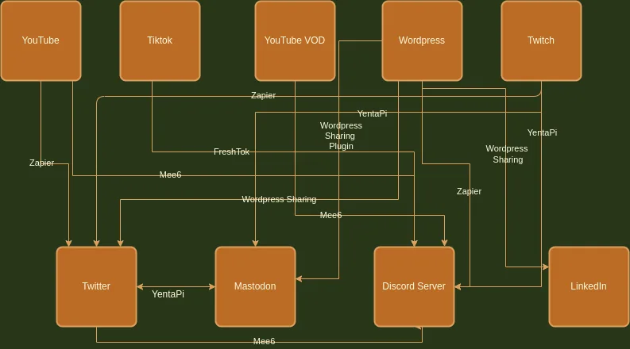

it's crucial to focus on the four "C's" of content creation: Content, Community, Consistency, and Communication. Creating engaging and high-quality content, building and maintaining a strong community, and being consistent with your content are all important elements.

However, communicating with your community across multiple platforms, including YouTube, Twitch, TikTok, Instagram, Twitter, LinkedIn, Discord, Mastodon, and your blog, can be a time-consuming task. The process of manually posting updates and alerts on each platform can be overwhelming, especially for those just starting out.

There are several services available that can automate this process, but many of them come at a cost. In my experience, I found myself paying for services such as Streamcord to get my Twitch alerts to Discord in a timely manner, and I also use the moderation bot Mee6 for Discord. However, even with these tools, I still had to split up my workflow into several different systems, some of which I host locally on a Raspberry Pi. I found my current method to be a great balance of services whilst reducing costs and maximizing impact.

Here's a breakdown of the platforms and tools I use for automating my content distribution:

- Zapier SaaS automation platform:
    - Twitch to Twitter: Monitors my Twitch for when I am live and posts to Twitter.
    - WordPress to Discord: Handles new blog post alerts to my Discord server I have for my community.
    - YouTube to Twitter: Handles when I post a video to my YouTube.
- Mee6 Discord bot:
    - YouTube to Discord: Handles the alerting from my main and VOD channel to my Discord.
    - Twitter to Discord: Handles alerting when I have made a post on Twitter inside the Discord.
- YentaPi Raspberry Pi locally hosted and run by me:
    - Twitch-and-toot: My own project I wrote to monitor my Twitch and post to Mastodon. You can find the code for this project on GitHub at [https://github.com/ChiefGyk3D/twitch-and-toot](https://github.com/ChiefGyk3D/twitch-and-toot).
    - Twitch-Discord-Bot: Open-source project to run a bot to monitor Twitch and post to Discord when I am live. You can find the code for this project on GitHub at [https://github.com/Siddhart/Twitch-Discord-Bot](https://github.com/Siddhart/Twitch-Discord-Bot).
    - Mastodon-Twitter-Sync: Open-source project to allow cross-posting to and from Twitter and Mastodon. I have it set up to conditionally cross-post messages when the “#sync” hashtag is added to either platform's toot or tweet. You can find the code for this project on GitHub at [https://github.com/klausi/mastodon-twitter-sync](https://github.com/klausi/mastodon-twitter-sync).

WordPress has several plugins and native integrations, including ActivityPub, LinkedIn, and Twitter, that make it easier to share my content on these platforms. However, I do plan to implement a way to alert Mastodon when I post a new YouTube video in the future. You can see a flowchart of how my current automations are setup.

