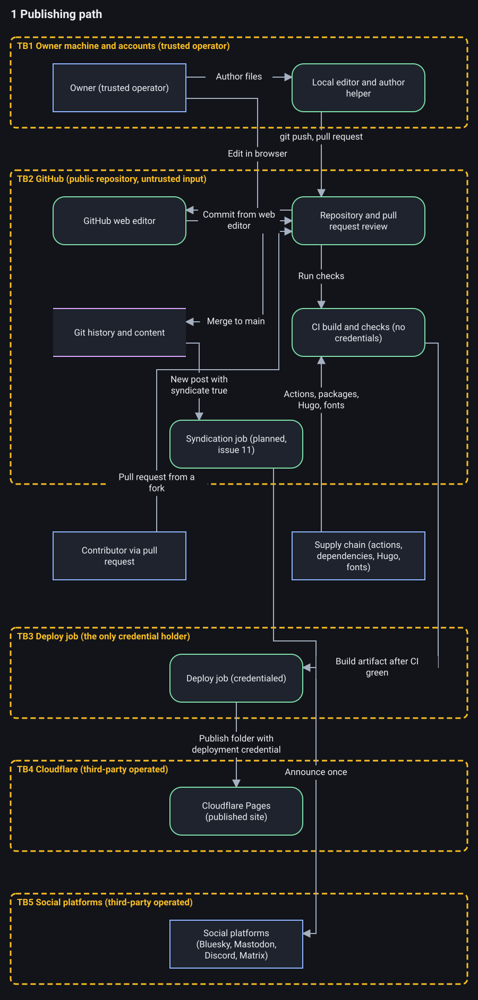
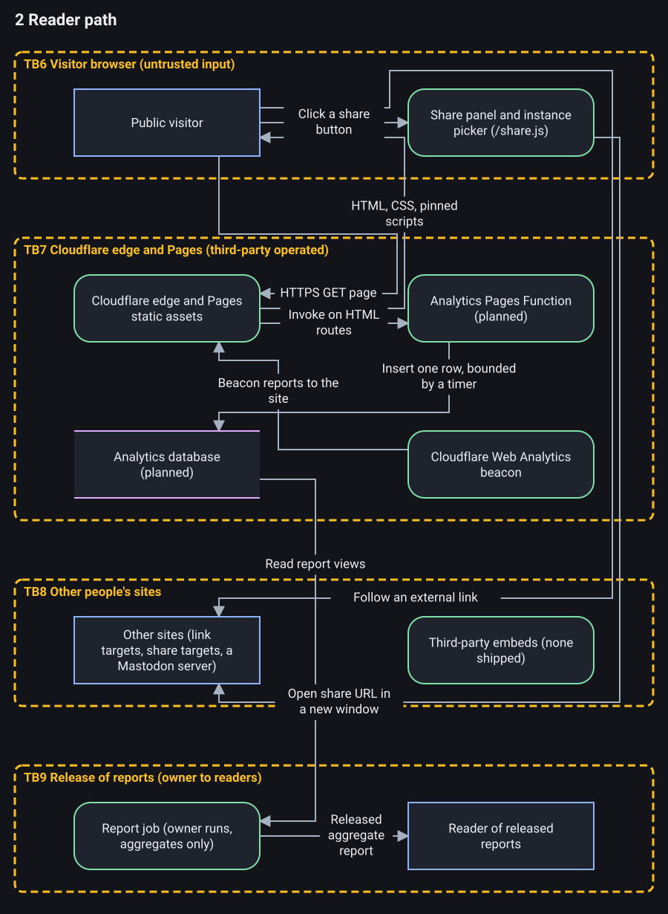
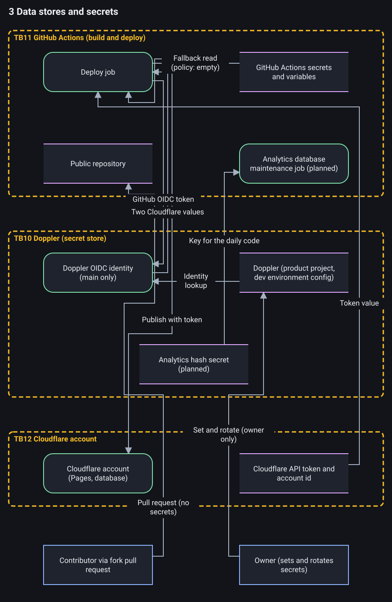

This site is a static personal site and work journal built with Hugo, without PHP or a database. I wrote the templates from scratch, kept the browser code small, and put the security, accessibility and performance rules into checks that can fail the build.

<!--more-->

## Why I built it

I built this because of PHP2Shell and my frustration with Matt Mullenweg and his toxicity. I covered the WordPress situation in [Who can't drive an Automattic? The fall of Wordpress and Matt Mullenweg](https://www.youtube.com/watch?v=FnoazrD6-Rg), [The Internet at Risk: WordPress Drama and Matt Mullenweg's Petty Fight Against WP Engine](https://www.youtube.com/watch?v=RqRZoQqKPgs), and [Automattic and Matt Mullenweg "Are Doing Open Source Dirty"](https://www.youtube.com/watch?v=QLEzJ3cXiWI).

I wanted something fast, light, capable, better designed and more secure, with the work open so other people could use it and learn from it. This is not a Hugo theme wrapped around somebody else's decisions.

I also built a converter that turns a WordPress export into Hugo page bundles, scrubs private data and preserves old addresses as redirects.

## What is here

Posts and work journal entries live in page bundles, with their Markdown and images together. They support tags, categories, archive notices, optional headline images, card thumbnails and social cards.

Search starts as a complete A to Z index, so it remains useful before JavaScript does anything. A small script adds filtering. The site also publishes RSS feeds, a sitemap, `robots.txt` and `llms.txt`.

The other pages cover About, Resume, Social links, Gear and tools, Support and Privacy, plus a useful 404 page instead of a blank shrug from the server.

Posts and journal entries have a share panel made from plain links without tracking parameters. Mastodon and Lemmy are the awkward pair because each needs an instance instead of one universal share address. Their buttons open an inline picker, validate the instance as a plain host name and build a fixed HTTPS share address in the browser. Nothing is sent while the visitor types, and the instance stays in local storage only when Remember is selected. Unticking it removes the stored value.

The authoring helper creates draft posts and journal entries, checks one page, adds cleaned JPEG or PNG images and starts a preview on loopback. It removes image metadata without re-encoding the picture, but refuses placeholder alt text, malformed files, unsafe paths, symlinks, oversized images, rotations it cannot safely correct and anything it would have to overwrite. It also refuses to edit the brand manifest because that records a human review.

## Small browser code

The site ships exactly three scripts:

- `/copy.js` on Support
- `/search.js` on Search
- `/share.js` on posts and journal entries

Each has a committed SHA-256 hash, a page allowlist and a budget below 1 KB gzip. Add a fourth script, change one without updating its hash, or put one on the wrong page, and the build fails.

The site's code sets no cookies and embeds nothing from another site. Cloudflare Web Analytics is enabled at the host and adds its own beacon at the edge, but the site does not run its own analytics yet.

A separate page-view counter using a Cloudflare Pages Function and D1 is built and tested locally, but it is not deployed and its privacy text is not live. The plan is to count successful HTML page views server side, honor Global Privacy Control and Do Not Track, keep narrowly defined aggregates, and update the Privacy page in the same change that enables it.

## Security in the build

The Content Security Policy begins with `default-src 'none'`. Images, styles, fonts, the manifest and scripts are restricted to approved sources, while base addresses, form submissions and framing are disabled. The headers also include `nosniff`, a strict referrer policy, one year of Strict Transport Security with subdomains, same-origin opener isolation, Trusted Types enforcement for scripts, and a Permissions Policy that disables features the site does not use.

CI calls reusable workflows pinned by commit. The local gate named `CI green` waits for them and is the single required check. Deployment proceeds from `main` only after that gate passes for the same commit.

Deployment credentials come from Doppler through OIDC instead of repository secrets. An automated check reviews the workflows and refuses forbidden secret references or credential placement.

The repository includes an OWASP Threat Dragon model covering the publishing path, reader path, data stores and secrets. It currently contains 63 threats: 33 Mitigated, 24 Open, 3 Accepted and 3 Not Applicable.

[Full size](threat-model-publishing.svg)

[Full size](threat-model-reader.svg)

[Full size](threat-model-secrets.svg)

Boxes are processes and stores, dashed boxes are trust boundaries, and arrows are data flows. The diagrams are generated from the same model file the checker reads, so the pictures and the checked model cannot drift apart.

And Mitigated has a deliberately narrow meaning: the control must exist in the repository, and the threat must name its path. Provider account settings remain Open until somebody checks them and records the date. The model checker proves that the structure and cited paths exist. It does not prove the control works.

Open items include account and machine security, provider controls, build-step egress, and controls for planned analytics and syndication work. Changes to architecture, data flow, secrets or third parties require the threat model to be updated in the same pull request.

## What the model says

Most of the real risk sits in the publishing path and the accounts behind it. A compromised owner account, build dependency, action, or deployment path can change what readers receive.

The reader path is small because the site serves static files. There is no PHP application, database, public admin login, runtime plugin system, or server-side code handling each request. The planned analytics function is not deployed.

Open means I have not recorded enough evidence to call the threat mitigated. Provider account settings remain Open until somebody checks them and records when they were checked. That is more useful than treating an assumption as a control.

The checker proves that the model has the required structure and that cited repository paths exist. It does not prove that a control works, that an account setting is correct, or that a dependency is trustworthy. Changes to the architecture, data flows, secrets, or third parties must update the model in the same pull request.

## Compared with a WordPress threat model

The difference is mostly where the reachable code and operational work live.

| Area | Typical WordPress site | This site |
| --- | --- | --- |
| Reader-path runtime | PHP application | Static files |
| Database | Required for site content and state | None |
| Login and admin surface | Public login and admin area | None on the public site |
| Third-party code | Plugins and themes run with the application | Build actions, dependencies, Hugo, and fonts |
| Patching | Core, plugins, and themes need continuing updates | Build tools and dependencies need continuing updates |
| Credentials | Database and application credentials on the server | Deployment credentials obtained through OIDC |
| Per-request reach | Attacker reaches the application | Attacker reaches the edge and static assets |
| Editor compromise | Can alter content and application state | Can publish altered static content |

WordPress has mature hardening options, and a well-run managed host removes much of the patching and operational burden. A properly maintained WordPress site is not automatically a bad design.

The static site moves risk instead of deleting it. The publishing path, owner accounts, CI configuration, deployment path, and software supply chain now carry more of the weight.

I am comparing attack surfaces, not choosing one platform to trust blindly. The model records what I checked, what remains Open, and where an assumption still needs evidence.
hook: Stop
hook: Stop
hook: Stop
hook: Stop
hook: Stop Completed
hook: Stop Completed
hook: Stop Completed

## Accessibility has limits

The templates include a skip link, landmarks, native controls, visible focus, reduced-motion and forced-colors rules, real text for disclosures, and controls at least 44 by 44 CSS pixels. Informative images cannot publish without alt text.

A browser gate runs a vendored, hash-pinned copy of axe-core and checks violations, focus order, keyboard behavior, horizontal overflow, small targets, failed requests, console errors and Content Security Policy violations. It covers widths down to 320 CSS pixels and a 200 percent zoom case.

But automated testing is still automated testing. Axe cannot decide every contrast case, the gate does not run a screen reader, and it does not exercise forced colors or print. No script proves accessibility conformance.

## Lab performance

I measured the site on 2026-11-09 with Lighthouse 13.6.0, Chromium 156.0.8078.47 headless and Hugo 0.168.0. Each result is the median of three runs per page and strategy against a local production build served on loopback with the build's own security headers and no compression.

Home, Search and About scored 100/100/100/100 for Performance, Accessibility, Best Practices and SEO on mobile and desktop. The migrated Mastodon relays guide, which has a hero image, scored 99/100/100/100 on mobile with a 2.0 s Largest Contentful Paint, and 100/100/100/100 on desktop.

Cumulative Layout Shift was 0 and Total Blocking Time was 0 ms on every measured page. `scripts/check-budget.py` also passed on that build.

These are lab numbers, not field data, and they move a few points between runs. I will measure again on the live domain after launch.

## Reach Around

[Reach Around](https://github.com/ChiefGyk3D/Reach-Around) is an upcoming self-hosted project for putting a creator's link page, media kit and numbers across platforms in one place using their own API keys. It is intended to replace Beacons.ai closely and then go further, but that is the plan, not a claim that every part is finished.

It is alpha software with breaking changes, no stable configuration format and no upgrade path promised between `0.x` releases. The latest published GitHub release is v0.2.2 from 2026-11-06. The `0.3.0` release candidates listed in the changelog are not published releases.

What exists includes a strict configuration loader, static link-page builder, non-root container, write-only click Worker, page-view rollups, platform count collection, and the media-kit and reporting work described in its public documentation. Research notes cover 16 platforms. Link clicks can use the anchor `ping` attribute, so that path does not need a browser script.

## Read the work

The [public repository](https://github.com/ChiefGyk3D/no-php-no-cry) contains the templates, checks, converter, threat model and documentation. Its [15-page wiki](https://github.com/ChiefGyk3D/no-php-no-cry/wiki) starts with the pinned toolchain, then follows the project through templates, build failures, CI, deployment, migration tooling, analytics and threat modeling.

Code is licensed under Apache-2.0. Written content and documentation use CC BY 4.0. The mascot, wordmark and logos are all rights reserved and are not licensed for reuse.

The unfinished pieces are documented too: deploying the site-owned analytics with its privacy text, building the syndication job, extending the authoring editor with its planned settings and publishing work, verifying provider-side security controls, and keeping the threat model current as those parts land.
